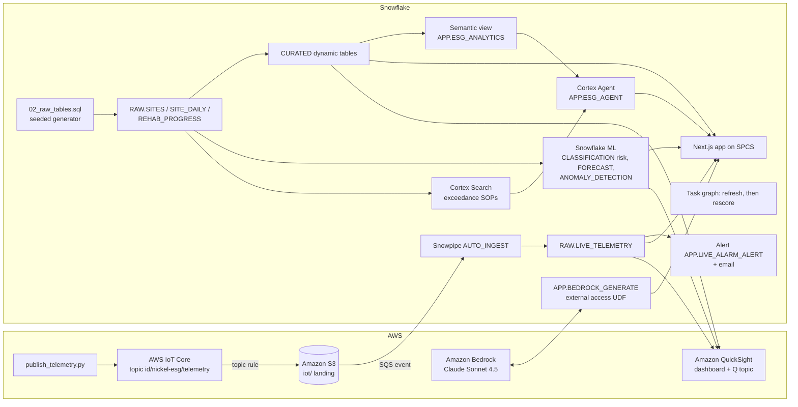

# Indonesia Nickel ESG Monitoring - Mining and Processing Sites

ESG monitoring for **30 sites of a fictional nickel mining and processing operator across 4 Indonesian provinces** (Central Sulawesi, Southeast Sulawesi, South Sulawesi, North Maluku) using Snowflake, optionally with AWS: from a live discharge-turbidity alarm to a 7-day exceedance-risk score, an alarm email and an AI action memo. The operator, its sites and all data are synthetic; nothing here describes the environmental performance of any real company or site.

## Architecture

An ESG monitoring pipeline built on **Snowflake** (Dynamic Tables, Snowflake ML, Cortex Search, Cortex Agent, Cortex AI_COMPLETE, SPCS) and, in the full build, **AWS** (IoT Core, S3, Bedrock Claude, QuickSight + Amazon Q). Site water-quality telemetry lands in `RAW.LIVE_TELEMETRY`. Dynamic tables curate 90 days of site-day history: discharge samples within an internal demo threshold, environmental exceedances, CO2e emissions and emissions intensity, community grievances, water treatment uptime and land rehabilitation. Snowflake ML scores 7-day exceedance risk per site, forecasts operator-wide daily emissions and flags discharge-turbidity anomalies. A Cortex Agent answers questions with SOP citations, and an LLM drafts the ESG action memo.

Interactive diagrams (hover for object names): [Snowflake only](docs/architecture-snowflake.html) | [AWS + Snowflake](docs/architecture-aws.html). The app shows both on its Architecture & Data tab, the current build first. Regenerate them with `python3 docs/build_architecture.py`.



The Snowflake-only build drops the AWS subgraph: `APP.SIMULATE_TELEMETRY` writes to `RAW.LIVE_TELEMETRY`, and the app calls Cortex `AI_COMPLETE` instead of the Bedrock UDF.

## Snowflake Capabilities

| Capability | Implementation |
|-----------|---------------|
| Dynamic Tables | `CURATED.KPI_SUMMARY`, `PERFORMANCE_SUMMARY`, `EXCEEDANCE_CAUSES`, `TREND_ANALYSIS` from the RAW tables |
| Snowflake ML | CLASSIFICATION 7-day exceedance risk (`ML.EXCEEDANCE_RISK_SCORES`), 14-day CO2e emissions FORECAST, discharge-turbidity ANOMALY_DETECTION |
| Cortex Search | 21 synthetic exceedance-response SOPs (one per site type and cause) in `SEARCH.ESG_SOP_SEARCH` |
| Semantic View | `APP.ESG_ANALYTICS` over sites, exceedance causes, daily totals and risk |
| Cortex Agent | `APP.ESG_AGENT`: Cortex Analyst over the semantic view plus Cortex Search for SOP citations |
| Cortex AI | `AI_COMPLETE('claude-sonnet-4-5')` for grounded answers, and for the action memo in the Snowflake-only build |
| Alerts + Tasks | `APP.LIVE_ALARM_ALERT` logs ALARM readings and sends email; task graph `TASK_REFRESH_CURATED`, then `TASK_RESCORE_RISK` |
| Snowpark Container Services | Next.js app `APP.ID_NICKEL_ESG_APP` with 6 tabs: Executive Cockpit, Predictive, Site Health, Live IoT, Ask AI, Architecture & Data |
| Snowpipe | `RAW.LIVE_TELEMETRY_PIPE` AUTO_INGEST from S3 (AWS build only) |

## AWS Services

Used only in the AWS + Snowflake build.

| Service | Role in Demo |
|---------|-------------|
| AWS IoT Core | Receives simulated site water-quality telemetry (discharge turbidity, settling-pond level). A topic rule writes each message to S3 |
| Amazon S3 | Landing bucket. An event notification goes to the Snowpipe SQS queue |
| Amazon Bedrock | Claude Sonnet 4.5 writes the action memo, called from Snowflake through an external-access UDF |
| Amazon QuickSight | DIRECT_QUERY executive dashboard over Snowflake (daily discharge within threshold, exceedances by site, exceedance risk) |
| Amazon Q | Natural-language questions over the QuickSight topic `id-nickel-esg-topic` |
| AWS IAM | Least-privilege roles for S3, IoT and Bedrock |

## Personas

These personas are fictional.

| Persona | Role | Key Questions |
|---------|------|---------------|
| **Dewi Kartika** | VP Sustainability and ESG | "Which province has the lowest share of discharge samples within threshold?" "Which exceedance causes put the most samples over the threshold?" |
| **Arif Nugroho** | Site Environmental Engineer | "Which sites are high exceedance risk this week, and which SOP applies?" |

## Data

All data is synthetic and seeded, so every rebuild reproduces it. The operator and site names are fictional; the four provinces are real Indonesian regions used only as labels. Thresholds are internal demo thresholds, not regulatory limits, and no figure is a compliance finding.

| Table | Rows | Description |
|-------|------|-------------|
| RAW.SITES | 30 | Sites across 4 provinces and 5 site types (Open-Pit Mine, RKEF Smelter, HPAL Plant, Tailings Facility, Jetty and Stockpile) |
| RAW.SITE_DAILY | 2,700 | Daily site observations over 90 days: water samples and samples within threshold, tonnes handled, t CO2e, grievances, exceedances, root cause, control inspections, treatment downtime, turbidity and settling-pond level |
| RAW.REHAB_PROGRESS | 30 | Disturbed and rehabilitated hectares per site |
| SEARCH.ESG_SOP_DOCS | 21 | Synthetic exceedance-response SOPs indexed for Cortex Search |
| RAW.LIVE_TELEMETRY | Grows during the demo | Live readings from IoT Core (AWS build) or `APP.SIMULATE_TELEMETRY` (Snowflake-only build) |
| ML.EXCEEDANCE_RISK_SCORES | 30 | 7-day exceedance probability and risk band per site |

## Build Instructions

### Prerequisites
- Snowflake account with ACCOUNTADMIN access, and Cortex AI enabled (AI_COMPLETE, Search, Agent).
- An X-Small warehouse with auto-suspend at or below 120 s, and an existing SPCS compute pool.
- Python 3.11+, `snowflake-connector-python`, Node.js 22+, Docker and the `snow` CLI.
- App image: run `snow spcs image-registry login`, then build and push `id-nickel-esg-app:v1` to the database's `APP.IMAGES` repository (see the header of `snowflake/07_deploy_app.sql`).
- AWS build only: `boto3`, AWS credentials for the target account (us-west-2) with Bedrock access, and QuickSight Enterprise.

### SPCS App
```
<DATABASE>.APP.ID_NICKEL_ESG_APP
```

### Tests
```bash
python -m pytest aws snowflake quicksight
```

For a local run, put `SNOWFLAKE_ACCOUNT`, `SNOWFLAKE_USER`, `SNOWFLAKE_DATABASE`, `SNOWFLAKE_WAREHOUSE`, `SNOWFLAKE_AUTHENTICATOR=PROGRAMMATIC_ACCESS_TOKEN`, `SNOWFLAKE_TOKEN` and `DEMO_PLATFORM` in the environment, then run `npm --prefix app run build && npm --prefix app start`.

## Build Modes

Both modes share the same core. They differ in three places, and the app's `DEMO_PLATFORM` setting (in its SPCS spec) switches the memo provider and the Live IoT tab.

| Layer | Snowflake Only | Full AWS + Snowflake |
|---|---|---|
| Live telemetry | `CALL APP.SIMULATE_TELEMETRY(n)` inserts simulated readings into `RAW.LIVE_TELEMETRY`. This simulates a sensor feed; it is not Snowpipe Streaming | `aws/publish_telemetry.py` to AWS IoT Core, then S3, SQS and Snowpipe AUTO_INGEST |
| Action memo | Cortex `AI_COMPLETE('claude-sonnet-4-5')` | Amazon Bedrock Claude Sonnet 4.5 through `APP.BEDROCK_GENERATE` |
| BI and natural-language questions | The SPCS app is the dashboard; questions go to the Cortex Agent | Also a QuickSight dashboard and an Amazon Q topic |
| App setting | `DEMO_PLATFORM: snowflake` | `DEMO_PLATFORM: aws` |

### Snowflake Only

```bash
# 1. Core data and dynamic tables (guarded: new isolated database only)
python snowflake/run_core.py --database INDONESIA_NICKEL_ESG_SNOWFLAKE --warehouse <XS_WAREHOUSE> --connection <CONNECTION> --apply
# 2. Native telemetry, ML, search, semantic view, agent, alert and task graph
python snowflake/run_intelligence.py --database INDONESIA_NICKEL_ESG_SNOWFLAKE --platform snowflake --warehouse <XS_WAREHOUSE> --connection <CONNECTION> --alert-email you@example.com
# 3. App on SPCS with DEMO_PLATFORM=snowflake (push the image first)
python snowflake/run_intelligence.py --database INDONESIA_NICKEL_ESG_SNOWFLAKE --platform snowflake --warehouse <XS_WAREHOUSE> --connection <CONNECTION> --alert-email you@example.com --files 07_deploy_app.sql --compute-pool <COMPUTE_POOL>
```

During the demo:
- Run `CALL APP.SIMULATE_TELEMETRY(20)` to add live readings. For a continuous feed, run `ALTER TASK APP.TASK_SIMULATE_TELEMETRY RESUME`, and `SUSPEND` it afterwards.
- Run `EXECUTE ALERT APP.LIVE_ALARM_ALERT` to raise the alarm email.
- Run `EXECUTE TASK APP.TASK_REFRESH_CURATED` to refresh the curated tables and rescore risk.

Afterwards, drop the database or run `ALTER SERVICE APP.ID_NICKEL_ESG_APP SUSPEND`.

### Full AWS + Snowflake

```bash
# 1. Core data and dynamic tables (guarded: new isolated database only)
python snowflake/run_core.py --database INDONESIA_NICKEL_ESG_AWS --warehouse <XS_WAREHOUSE> --connection <CONNECTION> --apply
# 2. AWS ingestion and Bedrock (dry run first, then --apply)
python aws/setup_aws.py --database INDONESIA_NICKEL_ESG_AWS --account <AWS_ACCOUNT_ID> --connection <CONNECTION> --apply
# 3. ML, search, semantic view, agent, alert and task graph
python snowflake/run_intelligence.py --database INDONESIA_NICKEL_ESG_AWS --platform aws --warehouse <XS_WAREHOUSE> --connection <CONNECTION> --alert-email you@example.com
# 4. App on SPCS with DEMO_PLATFORM=aws (push the image first)
python snowflake/run_intelligence.py --database INDONESIA_NICKEL_ESG_AWS --platform aws --warehouse <XS_WAREHOUSE> --connection <CONNECTION> --alert-email you@example.com --files 07_deploy_app.sql --compute-pool <COMPUTE_POOL>
# 5. QuickSight dashboard and Q topic (needs an existing Snowflake data source)
python quicksight/build_dashboards.py --database INDONESIA_NICKEL_ESG_AWS --account <AWS_ACCOUNT_ID> --principal-arn <QUICKSIGHT_USER_ARN> --data-source-arn <DATA_SOURCE_ARN> --prefix id-nickel-esg --apply --update --with-topic
```

QuickSight objects must be shared with the QuickSight user who signs in (`--principal-arn`); otherwise the console shows nothing.

During the demo:
- Run `python aws/publish_telemetry.py --count 20` to send live readings.
- Run `EXECUTE ALERT APP.LIVE_ALARM_ALERT` to raise the alarm email.
- Run `EXECUTE TASK APP.TASK_REFRESH_CURATED` to refresh the curated tables and rescore risk.

Afterwards, `python aws/teardown_aws.py --database INDONESIA_NICKEL_ESG_AWS --account <AWS_ACCOUNT_ID> --connection <CONNECTION> --apply` removes the AWS resources and the account-level Bedrock external-access and S3 storage integrations. It leaves the email integration `ID_NICKEL_ESG_EMAIL_INT`, which the Snowflake-only build also uses.

## Business Impact

Industry research:
- **Buyers and investors want responsibly produced minerals**: "Consumers and investors are increasingly calling for companies to source minerals that are sustainably and responsibly produced." -- [IEA, The Role of Critical Minerals in Clean Energy Transitions, executive summary](https://www.iea.org/reports/the-role-of-critical-minerals-in-clean-energy-transitions/executive-summary)
- **Emissions, waste and water are the core environmental risks**: "Tackling the environmental and social impacts of mineral developments will be essential, including the emissions associated with mining and processing, risks arising from inadequate waste and water management" -- [IEA, The Role of Critical Minerals in Clean Energy Transitions, executive summary](https://www.iea.org/reports/the-role-of-critical-minerals-in-clean-energy-transitions/executive-summary)

## Key Demo Numbers

These figures are synthetic and come from the seeded demo data. Forecast and anomaly figures can shift slightly with the build day.

- **30 sites**, 2,700 site-days over 90 days, across 4 provinces and 5 site types; **16,960,769 tonnes** of material handled and **48,415 water samples**
- **Discharge within threshold 88.3%**; per-site values range from 82.1% to 90.9%, and North Maluku is the lowest province at 87.6%
- **331 environmental exceedances** across 13 root causes; seepage turbidity puts the most samples over the threshold
- **Emissions intensity 192.2 kg CO2e/t** (3,260,220 t CO2e in total); RKEF smelters are highest at 904.5 kg CO2e/t
- **Exceedance-risk model** out-of-time holdout: precision 0.51, recall 0.50 at a 0.5 threshold, against a 0.43 base rate. 17 sites are high risk; the top site is ST-0014, at 98.4%
- **14-day CO2e emissions forecast** with prediction intervals; **28 of 480** site-days flagged as discharge-turbidity anomalies
- **Water treatment uptime 98.1%**, land rehabilitated 50.2%, 75 community grievances
- **21 SOPs** indexed for Cortex Search and cited by ID in agent answers

## License

Apache 2.0 — See [LICENSE](LICENSE) for details.

This is a personal demo project and is not an official Snowflake offering. It comes with no support or warranty. The operator, sites and figures are synthetic and do not describe any real company or site. Industry statements cited are from publicly available third-party research; they are context, not guarantees of results.
